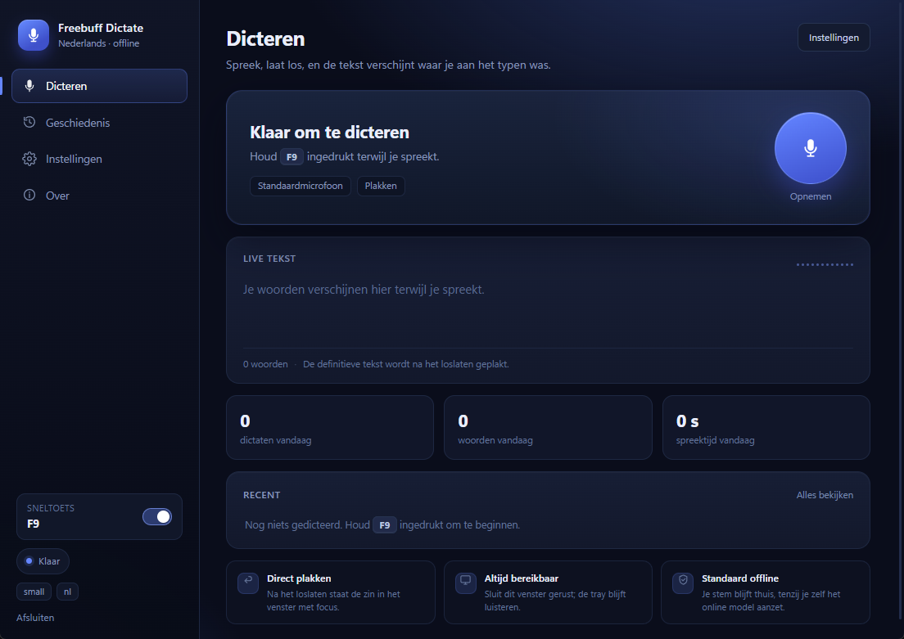

# Freebuff Dictate



Offline-first voice-to-text for any Windows app — built so you can **talk to
Freebuff instead of typing**. Hold a hotkey, speak, let go, and the sentence is
pasted into whatever window has focus (the Freebuff prompt box included). Words
appear live while you talk, both in the app window and in a small overlay when
the window is out of the way.

By default everything runs on your machine: no account, no API key, no audio
leaving the PC, and the only network access is the one-time model download.
If you want more accuracy than the local `small` model, **Instellingen → Online
model** can use Groq's free Whisper tier; only the finished utterance is then
uploaded, and the preview plus fallback stay local. See [Online model](#online-model-gratis).

The delivered configuration is **Dutch**: `"language": "nl"`, the multilingual
`small` model for the text that gets pasted, and `base` for the live preview.

**At a glance**

* **Dictate anywhere** - hold `F9`, speak, release; the sentence is pasted into
  the focused window of any Windows app.
* **Runs on your PC** - Whisper via faster-whisper, no account and no audio
  upload by default; the model is downloaded once.
* **Live words** - a preview while you speak, in the window and in a small
  overlay when the window is closed.
* **Tray app** - closing the window keeps dictation running; per-user installer,
  start with Windows, uninstaller that keeps or removes your data.
* **Optional online model** - bring your own free Groq key for more accuracy;
  the preview and the fallback stay local.

---

## Install (Windows)

Run **`Freebuff-Dictate-Setup-<version>.exe`** and follow the wizard. It
installs for the current user only - no administrator prompt, nothing
machine-wide:

* The program goes to `%LOCALAPPDATA%\Programs\Freebuff Dictate`, with a Start
  Menu folder, an entry in **Apps & Features** and its own uninstaller.
* A desktop shortcut and "start when I sign in" are checkboxes in the wizard.
  Both can be changed later from the app.
* Uninstalling asks whether to delete your dictations and settings as well;
  answering no keeps them for a later install.

The installed app keeps everything it writes - `config.json`, history, learned
corrections, the encrypted Groq key, logs and the downloaded Whisper models -
in `%APPDATA%\Freebuff Dictate`, not in the program folder. Upgrading or
uninstalling therefore never loses your data by accident, and **Map openen**
and **Logbestand openen** in the app point at that folder.

The first installation seeds that folder with the same Dutch configuration as
this checkout (`language` `nl`, `small` model, `base` preview). Reinstalling or
upgrading never overwrites an existing `config.json`.

Windows 11 and recent Windows 10 already include the Edge WebView2 runtime the
window needs; the installer checks for it and offers the download when it is
missing. 64-bit Windows is required.

The rest of this README describes running the app from a checkout; the
installed build behaves the same, minus the console scripts.

---

## Quick start

1. Double-click **`Freebuff Dictate.vbs`** (or the Start Menu entry, when
   installed). The app window opens and a microphone icon appears in the
   notification area.
2. Click into Freebuff's prompt box.
3. **Hold F9**, speak normally, **release**.
4. The words grow in the *Live tekst* card (and in the overlay, if the window is
   closed). A moment after you release, the finished sentence is pasted.

Press **Opnemen** in the window to record without the hotkey. Closing the window
does **not** quit: dictation keeps working from the tray, and double-clicking the
tray icon (or starting the app again) brings the window back.

Audio cues: `beep beep` (high) = recording started, `beep` = stopped and
thinking, `beep-beep` (rising) = pasted, low buzz = failed / too short / no
speech. Turn them off in Settings, or switch off **Indrukken om te praten** for
the old press-to-start/press-to-stop flow.

---

## The window

The window is a normal desktop app (Edge WebView2 inside a native frame) with
four views in the sidebar.

**Dicteren** — the screen you use every day:

* A status card that says what the app is doing, the hotkey, the selected
  microphone and the delivery mode.
* A big **Opnemen** button (stop-and-paste while recording).
* **Live tekst** with a level meter and a recording timer. The text here is the
  incremental preview; the final wording replaces it after release.
* Counters for today (dictations, words, speaking time), and the three most
  recent dictations for one-click copying.
* A switch under **Sneltoets** pauses global listening without quitting.

**Geschiedenis** — every dictation is kept locally (`history.json`, newest 200)
with its time, word count, duration and delivery mode. Search filters as you
type, the list is grouped by day, and every item has edit / copy / delete. The
edit button opens the text in place; saving a correction is also how the app
learns (see below). Clear asks for a second click first.

**Instellingen** — all the useful `config.json` keys, with explanations:

* language, main model, preview model, microphone, CPU threads, beam size;
* the **Microfoon** list is built from the input devices Windows exposes. The
  app saves the device name, not its Windows index, so a headset or webcam that
  renumbers does not silently become another device. **Vernieuwen** rescans
  after plugging something in. If the saved device is missing, a warning at
  the top of the window names it and links straight to the microphone list;
* **Microfoon testen** records two seconds from the microphone that is selected
  in the form and shows its level in dBFS with a verdict (goed / zacht / stil);
* the hotkey field is a recorder: click it and press the combination, no need to
  type `<ctrl>+<alt>+d` by hand. Escape cancels;
* hold-to-talk, overlay, live preview, beeps, trailing space, clipboard restore;
* a **Leren** card with the switch for correction learning, the words the app
  learned, and a forget button per item;
* an **Online model** card: local or Groq's free tier, with a field for the
  encrypted API key and the free-tier limits;
* **Start met Windows**, **Crashlog opslaan**, log/crashlog/folder buttons, and
  the path of `config.json`.
* if the previous run ended unexpectedly and wrote a crash report, the next
  launch shows a notice at the top of the window with **Crashlog openen** and a
  close button. A normal quit leaves no notice.

Saving validates first: an invalid hotkey or an English-only model with a
non-English language is refused with a readable message and nothing is written.
Changes are applied live — the hotkey is re-armed, the model reloads in the
background when needed.

**Over** — version, the active transcription engine (local Whisper or Groq),
active models, where things live on disk, and the quit button.

The window remembers its size and position in `ui-state.json` next to
`config.json`; the first launch opens centred. Closing it hides it and shows a
one-time tray notification; the tray menu and **Afsluiten** are the ways to
quit.

---

## The tray icon

The icon colour tells you what the app is doing:

| icon | meaning |
| --- | --- |
| blue mic | armed, waiting for the hotkey |
| red mic | recording - talking (release to paste) |
| amber mic | transcribing |
| grey mic | hotkey disabled (paused) |

Double-click opens the window. Right-click for:

* **Klaar - houd F9 ingedrukt om te praten** — status line.
* **Opnemen / Stop en plak** — start/stop without the hotkey (handy with a
  touchscreen or when another app owns F9).
* **Sneltoets actief** — pauses global listening without quitting (the icon
  turns grey). Nothing is captured while paused.
* **Instellingen** — opens the window on the settings view.
* **Starten met Windows** — writes/removes a shortcut in your Startup folder.
* **Logbestand openen** / **Crashlog openen** / **Map openen** / **Afsluiten**.

---

## Hold to talk

With **Indrukken om te praten** on (the default), the hotkey behaves like a
walkie-talkie button: press and keep speaking, release to paste. A tap shorter
than `min_seconds` is discarded, so a stray key press does nothing.

While you hold it:

* with the window open, the words appear in **Live tekst**;
* with the window closed, a borderless overlay sits above the taskbar showing
  the same words and a level meter.

The overlay never takes keyboard focus: it is marked `WS_EX_NOACTIVATE` and
shown with `SW_SHOWNOACTIVATE`, so the paste still goes to the window you were
typing in.

The preview is incremental: each pass transcribes only the uncommitted tail of
the audio plus a short overlap, and the overlap is de-duplicated word by word,
so the text grows without repeating itself and long dictation does not get
slower per update. It is a hint, not the final text: on release the whole
utterance is transcribed again (with VAD and your configured beam size) and that
is what gets pasted.

---

## Leren van je correcties

Dictation is never silently guessed at. When a word was recognised wrongly,
open **Geschiedenis**, click the pencil, fix the wording and save. The edited
text is stored like any history item, and the app learns two things from the
difference:

* **word corrections** — a changed single word (`inluchtpagina` →
  `inlogpagina`) is remembered and applied to future transcripts as a whole
  word, regardless of capitals. Substrings are left alone.
* **eigen woorden** — names and identifiers the user typed in the correction
  (`Codebuff`, `WebSocket`, `useEffect`) are added to Whisper's
  `initial_prompt`, so the model is nudged to spell them that way.

Only single-word replacements become corrections; a rephrase like "web socket"
→ "WebSocket" would otherwise teach half a phrase to the wrong word. Name-like
vocabulary is still learned from such an edit, and capitalisation-only fixes are
recognised as proper nouns. Common words ("de" → "het") are ignored, and so is
capitalisation that is merely the start of a sentence.

The result: the next time you dictate the same name, it comes out the way you
wrote it. Everything is local in `learning.json` next to `config.json`.

In **Instellingen → Leren** you can see exactly what was learned, remove a
single correction or word, or forget everything. Turning off **Leren van
correcties** stops new learning; existing corrections stay active until you
remove them. Nothing is learned from ordinary dictation you did not edit.

---

## Online model (gratis)

Groq's free Whisper tier runs `whisper-large-v3-turbo` — the same family as the
local model, but a much larger network and therefore noticeably better at names,
jargon and punctuation. It costs nothing within the free limits and needs no
credit card.

**Turn it on**

1. Create a key at <https://console.groq.com/keys> (a free Groq account).
2. Open **Instellingen → Online model**, paste the key and click **Opslaan**.
3. Set **Transcriptie** to **Groq gratis (online)** and click the page's
   **Opslaan** button. The sidebar then shows *online* instead of *offline*.

**What leaves the PC**

Only the finished clip of one dictation, as a 16 kHz mono WAV. The live preview
never goes online: it would mean uploading audio every half second. The text is
post-processed and delivered exactly like a local transcript. Learned words are
sent as the prompt, so the self-learning layer also helps in the cloud.

**Free limits** (Groq, October 2026): 20 requests/minute, 2,000/day, 7,200 audio
seconds/hour and 28,800 audio seconds/day; uploads up to 25 MB. For normal
dictation the daily allowance is hours of speech. Limits can change — the card
in Settings shows the current wording.

**If it fails, dictation continues**

No key, no network, an invalid key or a reached limit falls back to the local
model automatically, with one readable notification instead of a lost sentence.
The failure is logged (never the key) and the next clip tries the chosen backend
again.

**Key storage**

The key is encrypted with the Windows Data Protection API (DPAPI) and written to
`credentials.json` next to `config.json`. It is tied to your Windows account,
never put in `config.json`, never logged and never returned to the window. Use
**Sleutel verwijderen** in Settings (or delete `credentials.json`) to remove it.

**No account?** The local model list now includes `large-v3-turbo`: about 1.6 GB
to download, materially better than `small`, and completely offline. It is
slower on a four-thread CPU, so the cloud option is mainly a speed/accuracy
trade for people who dictate a lot.

---

## How it works

```
mic (44.1/48 kHz) -> box-average decimation to 16 kHz -> faster-whisper (CTranslate2 int8)
   -> text -> clipboard -> simulated Ctrl+V into the focused window

optional: the final clip -> Groq (whisper-large-v3-turbo) -> text
          on any error -> the local path above
```

* The interface is a pywebview window; Python pushes state, partial text and
  levels into the page with `window.dictate.push(...)`, and the page calls a
  small `Api` object for actions. No local HTTP server, no browser.
* Recording happens on the audio callback thread; transcription runs on a
  worker thread, so the hotkey stays responsive and two presses can never
  overlap. A watchdog auto-stops at `max_seconds`.
* The clipboard is restored ~0.6 s after pasting, so dictation does not eat
  whatever you had copied.
* Text is appended with a trailing space (`post_space`) so you can keep typing
  or dictating after it.
* Learned corrections are applied between transcription and delivery, and the
  learned vocabulary is added to the prompt on each pass. Both hooks live in
  the engine (`postprocess` / `extra_prompt`), so the console path and the
  window use the same behaviour.
* Whisper occasionally invents a short word out of microphone noise. A result
  that is a single word of three characters or fewer on a very quiet recording
  is discarded rather than pasted, and the VAD threshold is slightly stricter
  than the library default. Holding the key in a noisy room can still pick up
  the room, exactly as any microphone would.

---

## config.json

| key | default | meaning |
| --- | --- | --- |
| `hotkey` | `"<f9>"` | Any pynput hotkey string, e.g. `"<f9>"`, `"<ctrl>+<alt>+d"`, `"<ctrl>+<shift>+<space>"`. |
| `hold_to_talk` | `true` | `true` = hold the hotkey while speaking. `false` = press to start, press again to stop. |
| `overlay` | `true` | The live overlay when the window is hidden. Turning it off also stops the background preview passes. |
| `stream_preview` | `true` | Incremental preview transcription. Capped by the keys below. |
| `stream_chunk_seconds` | `1.6` | How much uncommitted audio to accumulate before a preview pass. |
| `stream_overlap_seconds` | `0.8` | Audio re-read at the start of each pass, trimmed again by word matching. |
| `stream_poll_seconds` | `0.45` | How often the preview worker looks for new audio. |
| `model` | `"small"` | The accurate pass that produces the pasted text. `.en` models are English-only; `small`/`base`/`medium`/`large-v3-turbo` are multilingual. |
| `preview_model` | `"base"` | Drives the live text only. `""` means "same as `model`". A smaller multilingual model keeps the preview live. |
| `language` | `"nl"` | `nl` Dutch, `en` English, `""`/`auto` detect. Must match a multilingual model. |
| `input_device` | `null` | `null` = Windows default mic. Otherwise the full device name from the Microfoon list; name fragments and old indices still work. |
| `compute_type` | `"int8"` | Leave as is unless you are experimenting. |
| `cpu_threads` | `4` | Cores to use. Lower it if dictation stutters your game. |
| `beam_size` | `1` | `1` = fast. `5` = marginally more accurate, ~40 % slower. |
| `mode` | `"paste"` | `paste` = Ctrl+V, `clipboard` = copy only, `type` = type characters out. |
| `restore_clipboard` | `true` | Put your previous clipboard back after the paste. |
| `post_space` | `true` | Append a space to the dictated text. |
| `initial_prompt` | `""` | Words/names to bias spelling, e.g. `"Freebuff, Codebuff, React, TypeScript"`. |
| `max_seconds` | `120` | Safety auto-stop. |
| `min_seconds` | `0.35` | Shorter clips are discarded as accidental taps. |
| `beeps` | `true` | Audio feedback (useful when the window is hidden). |
| `learn_from_corrections` | `true` | Learn spelling corrections from edits in Geschiedenis. Existing learning stays active when off. |
| `crash_logging` | `true` | Write unhandled exceptions and fatal native crashes to `crash.log`. The report has a traceback and app/OS details, never dictation text, clipboard contents or the Groq key. |
| `online_backend` | `"local"` | `local` keeps all audio on the PC. `groq` sends only the finished clip to Groq's free Whisper tier. |
| `online_timeout_seconds` | `30` | How long to wait for Groq before falling back to the local model. |

Editing `config.json` by hand requires a restart; the window applies and writes
it for you. `ui-state.json` (window size/position), `learning.json` (learned
corrections), `credentials.json` (the encrypted Groq key, if you use one),
`crash.log` (when crash logging is on) and the temporary `crash-run.json` run
marker are created next to it; delete the first to re-centre the window,the second to forget everything learned, the third to remove the online key, and
the fourth to clear the crash history. A `history.json` or `learning.json` that
cannot be read is first copied to a timestamped `.bak` next to it (for example
`history.json.20261023-141605.bak`), so a damaged file is never lost to the next
write. The run marker is removed on a normal quit and should only be present
while the app is running or after a crash.

---

## Dutch

Dutch is not a translation layer - it is simply the right model and language
setting:

```json
"model": "small",
"preview_model": "base",
"language": "nl"
```

Measured on this machine, on real Dutch speech (3 samples, same CPU, int8,
`beam_size` 1):

| model | result | per pass |
| --- | --- | --- |
| `base` | "inluchtpagina" for *inlogpagina*, "bekoff" for *backoff*, accents dropped | ~0.7 s |
| `small` | 2 of 3 sentences exact, the third kept *exponentiële* and *backoff* | ~2.4 s |
| `tiny` | "Vog een donker moders" - unusable | ~0.4 s |

So `small` does the final pass and `base` only paints the preview: a `small`
preview needs ~2.3 s per 1.6 s of speech and would fall behind while you talk,
where `base` finishes the same slice in ~0.7 s. The pasted text is always the
`small` result.

English-only models (anything ending in `.en`) cannot transcribe Dutch. The app
logs a warning if the pair does not match and Settings refuses to save that
combination.

**Mixed Dutch and English.** Keep `language: "nl"` if you mostly speak Dutch -
product names and code identifiers usually survive, especially if they are in
`initial_prompt`. For genuine back-and-forth, `"auto"` lets the model decide per
clip, but short clips sometimes pick the wrong language.

---

## Choosing a model / speed

Measured on this machine (i7-7700, 4 cores / 8 threads) **while a game was
running**, so real idle numbers will be better:

| model | 7 s of speech | notes |
| --- | --- | --- |
| `tiny.en` | ~2 s | Fast, drops punctuation and technical terms. |
| `base.en` | ~2 s | Good for English; same wording as `small.en` on test clips. |
| `small.en` | ~7-10 s | Slowest; worth it if `base.en` mishears your accent. |
| `large-v3-turbo` | ~4-9 s (estimate) | Big step up from `small`; ~1.6 GB download. Measured timings vary by CPU. |

Dutch (the current setting) uses `small` + `preview_model` `base`, both already
downloaded. `large-v3-turbo` is the stronger offline choice if you have the
disk space and do not mind waiting a little longer for the final text. The model dropdown labels English-only models in their own group;
the selected model's trade-off is shown underneath.

Preview passes run in the background while you talk, so they compete with the
final pass for CPU: a 1.6 s preview slice took ~0.3 s on an idle machine and up
to several seconds while a game was using all four cores. The preview simply
lags behind in that case - it never blocks the recording, and the text you get
pasted is always produced from the full clip after you release the key.

---

## Commands

```bat
Freebuff Dictate.vbs               the app: window + tray, no console
dictate.bat                        console mode (no window, no tray icon)
.venv\Scripts\pythonw.exe tray.pyw --settings   open the window on Settings
.venv\Scripts\pythonw.exe tray.pyw --hidden     start in the tray only (login)

.venv\Scripts\python.exe autostart.py status     is the login shortcut installed?
.venv\Scripts\python.exe autostart.py enable     start with Windows
.venv\Scripts\python.exe autostart.py disable    stop starting with Windows

.venv\Scripts\python.exe dictate.py --list-devices
.venv\Scripts\python.exe dictate.py --model small.en
.venv\Scripts\python.exe dictate.py --device "USB"
.venv\Scripts\python.exe dictate.py --no-paste          copy only, no Ctrl+V
.venv\Scripts\python.exe dictate.py --test-wav sample_tts.wav
.venv\Scripts\python.exe dictate.py --once 5            record 5 s, print text, exit

.venv\Scripts\python.exe selftest.py     156 checks: config, audio, models, overlay, tray, settings, learning, placement
.venv\Scripts\python.exe verify_ui.py    60 checks: the real window and bridge, live text, correction learning, history, mic picker, mic test, quit
.venv\Scripts\python.exe verify_tray.py  33 checks: tray, window, close-to-tray, hold-to-talk, single instance
pwsh -File setup.ps1                     reinstall deps / re-download model
```

`sample_tts.wav` and `sample_tech.wav` are synthesised English clips;
`sample_nl.mp3` and `sample_nl_tech.mp3` are Dutch ones (the second is the
"websocket / exponentiële backoff" sentence). They are handy for checking the
pipeline after any dependency change; `selftest.py` uses the Dutch pair to
verify the configured model and language.

---

## Building the installer

After `setup.ps1` has created the venv:

```bat
build-installer.cmd                self-tests, then the app folder and installer
build-installer.cmd -SkipTests     skip the test suite
build-installer.cmd -ExeOnly       only dist\Freebuff Dictate\
```

`build-installer.ps1` installs PyInstaller into the venv, builds
`FreebuffDictate.spec`, and then compiles `installer\FreebuffDictate.nsi` with
NSIS. If `makensis.exe` is not installed, the script downloads NSIS 3.11 into
`tools\` once - no admin rights needed for that either.

Outputs:

* `dist\Freebuff Dictate\Freebuff Dictate.exe` plus `_internal\` (about 300 MB,
  including CTranslate2, PyAV, WebView2 Python bindings and Tcl/Tk). Runs as-is.
* `dist\Freebuff-Dictate-Setup-<version>.exe` (about 75 MB).

The version comes from `APP_VERSION` in `desktop.py`; bump it there and in
`installer\version_info.txt` when releasing. That file is the Windows version
resource PyInstaller embeds in the exe, and it repeats the number four times
(`filevers`, `prodvers`, `FileVersion`, `ProductVersion`). The build runs
`installer/version.py --check` first and stops if any of them disagrees with
`APP_VERSION`, so the exe cannot be labelled with an old version.

The installer is per-user, x64 and writes its `Uninstall` entry under
`HKCU\Software\Microsoft\Windows\CurrentVersion\Uninstall`.

To run a packaged build against throwaway data - for testing, without touching
`%APPDATA%` - set `FREEBUFF_DICTATE_DATA` to a folder before starting the exe.
The app then keeps its config, history and models there.

---

## Code signing

Windows shows **Unknown publisher** until the exe carries a signature from a
certificate it trusts. That trust comes from a certificate authority - an OV or
EV code-signing certificate, or Microsoft's Azure Trusted Signing. A
self-signed certificate signs the files but does *not* change the SmartScreen
warning; it is only useful on machines that import its root certificate.

The build signs both `Freebuff Dictate.exe` and the setup when a certificate is
configured:

```bat
set FREEBUFF_SIGN_PFX=C:\certs\freebuff.pfx
set FREEBUFF_SIGN_PFX_PASSWORD=your-password
build-installer.cmd

rem or a certificate in CurrentUser\My / LocalMachine\My (USB tokens work):
build-installer.cmd -CertThumbprint 1A2B3C4D5E...

rem release build: fail instead of shipping unsigned files
build-installer.cmd -RequireSignature
```

[sign.ps1](sign.ps1) signs with SHA-256 and a DigiCert timestamp by default
(`-TimestampServer` changes that), and prints the signer fingerprint plus the
verification result for every file. The certificate password is read from
`FREEBUFF_SIGN_PFX_PASSWORD` so it stays out of the command line. Without a
certificate the build still succeeds, with a warning that the installer is
unsigned.

Check a result with `Get-AuthenticodeSignature dist\Freebuff-Dictate-Setup-1.6.exe`:
the status is `Valid` once Windows trusts the chain. Freshly issued OV
certificates may still trip SmartScreen until the file has download
reputation; EV certificates and Trusted Signing start with reputation.

Hardware tokens sign through the thumbprint path (Windows asks for the PIN).
Azure Trusted Signing needs Microsoft's `signtool` with its dlib: sign
`dist\Freebuff Dictate\Freebuff Dictate.exe` before building the installer and
the setup afterwards with that tool instead of `sign.ps1`.

On GitHub, [.github/workflows/build-installer.yml](.github/workflows/build-installer.yml)
runs the same build on a Windows runner for pushes, pull requests and `v*`
tags. It signs when the repository secrets `FREEBUFF_SIGN_PFX_BASE64` (the .pfx,
base64-encoded) and `FREEBUFF_SIGN_PFX_PASSWORD` are set, refuses to build a
tagged release without them, verifies the result, and uploads the setup exe as
a workflow artifact. CI byte-compiles instead of running the model-heavy
self-tests; run `build-installer.ps1` locally for those.

Pushing a tag such as `v1.7.0` also publishes the signed setup exe as an asset
of a GitHub Release with generated notes; a tag with a suffix such as
`v1.7.0-beta.1` becomes a pre-release. Re-running the job for an existing tag
replaces its asset instead of failing. Releases are created with the workflow's
own `GITHUB_TOKEN` - the release job alone gets `contents: write` - so no extra
token is needed. The build refuses a tag that does not name the same version as
`APP_VERSION` (`v1.6`, `v1.6.0`, `v1.6.0.0` and `v1.6.0-beta.1` all match 1.6),
so a `v1.7` tag on a 1.6 build fails instead of shipping an exe that still says
1.6. Bump `APP_VERSION` in `desktop.py` and the version in
`installer\version_info.txt` before tagging.

---

## Troubleshooting

**The window does not open.** Check `dictate.log`; a missing Edge WebView2
runtime is the usual cause. It ships with Windows 10/11; if it was removed,
install "Microsoft Edge WebView2 Runtime", then run `setup.ps1`. The app itself
keeps working from the tray even if the window cannot start.

**Dutch text comes out as English gibberish.** The model is still an `.en` one.
Set `model` to `small` (or `base`) and `language` to `nl` in Settings; Settings
blocks an English-only model with a non-English language.

**"no speech detected" / silence.** Wrong device. Open Settings → **Microfoon**,
click **Vernieuwen** if the device was just plugged in, then pick the microphone
that Windows shows under **Geluid → Invoer** and press **Test 2 seconden** to see
the level. An interface's line input is very quiet unless something is plugged
into it. Also check Windows Settings → Privacy →
Microphone → "Let desktop apps access your microphone".

**The microphone test says "stil".** The selected input is muted or the wrong
one. Pick another entry in the Microphone dropdown and test again; the test uses
the selection in the form, not the saved one.

**The hotkey recorder will not accept a key.** Use a function key (F9) or a
combination with Ctrl, Alt or Shift; a bare letter would hijack typing
everywhere. Escape cancels.

**Text appears somewhere unexpected.** Freebuff's window was not focused when
the transcription finished. Use `"mode": "clipboard"` to review before pasting,
or paste faster.

**Nothing happens on F9.** Check the tray icon is blue, not grey (sidebar switch
**Sneltoets** on). Another app may own F9 — record a new combination in
Settings. Only one copy may run at a time (`dictate.lock`); starting a second one
brings the existing window forward.

**Closing the window seems to quit.** It does not: the tray icon stays and
dictation keeps working. Use the tray menu → **Afsluiten** (or Settings → Over →
Afsluiten) to really quit.

**The tray icon vanished.** Click the `^` chevron in the notification area and
drag the mic out onto the taskbar to pin it, or start the app again.

**Transcription slow / game stutters.** Set `cpu_threads` to `2`, or switch to
`base`/`tiny`. Whisper competes with whatever else is on the CPU. If only the
preview feels laggy, turn off **Live voorbeeldberekening** or the overlay; the
final paste stays fast.

**Something odd got pasted ("and then and and and").** Whisper hallucinating on
microphone noise, usually a line input with nothing plugged in. Pick the real
microphone in Settings, drop its gain, or disable the preview - and note that
holding the key while the room is noisy will transcribe the room.

**The overlay does not appear.** It is only used while the window is hidden;
with the window open the words appear in **Live tekst** instead. Check the tray
icon turns red on hold.

**The window is in the wrong place / too big.** It remembers its last position
in `ui-state.json`; close it, delete that file, and reopen to re-centre.

Logs: `dictate.log` (rotates at 1 MB). **Crashlog opslaan** is on by default
and adds `crash.log` next to it for unhandled Python exceptions and fatal
native crashes; **Crashlog openen** is in Settings, Over and the tray menu. A
startup crash when launched hidden? Run `dictate.bat` for a console, or read
`dictate.log` / `crash.log`. When the previous run left a new crash report, the
window opens with a notice at the top; clicking **Crashlog openen** there goes
straight to the report. The temporary `crash-run.json` marker next to the log
is removed on a normal quit.

---

## Start with Windows

Tick **Start met Windows** in Settings (or in the tray menu). That creates
`Freebuff Dictate.lnk` in
`%APPDATA%\Microsoft\Windows\Start Menu\Programs\Startup`, launching
`pythonw tray.pyw --hidden` from a checkout, or `Freebuff Dictate.exe --hidden`
when installed - no console flash, no window at login, per-user only, no admin
rights. The installer's "start when I sign in" checkbox writes the same
shortcut. Untick it (or `autostart.py disable`) to remove the file again; that
is the whole feature.

## Uninstall

**Installed:** open Windows Settings → Apps → Installed apps (or the Start Menu
folder) and uninstall *Freebuff Dictate*. The program, shortcuts, login entry
and registry entry are removed; you are then asked whether to delete
`%APPDATA%\Freebuff Dictate` too. Silent uninstalls (`uninstall.exe /S`) always
keep that folder.

**Checkout:** turn off the login toggle first, then delete this folder
(`C:\path\to\FreebuffDictate`). Nothing is installed system-wide - the venv,
models, logs, window placement, learned corrections and the shortcut all live
here or in the Startup folder.

---

## License

[MIT](LICENSE) - use it, change it, ship it, sell it; keep the copyright notice.
